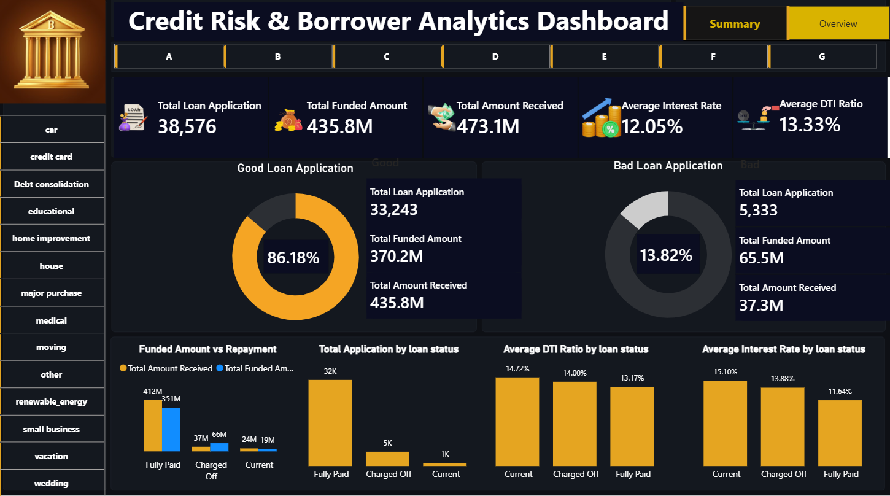
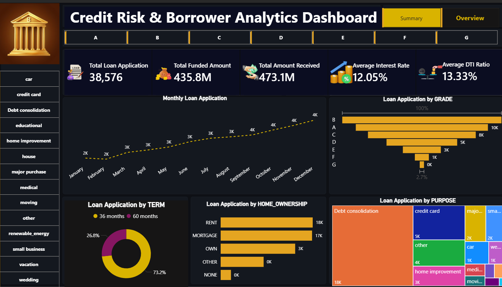

An interactive Power BI dashboard for analyzing credit risk, borrower behavior, loan portfolio performance, repayment trends, and lending insights using KPIs and data visualizations.
# 🏦 Credit Risk & Borrower Analytics Dashboard

<p align="center">
  <strong>Transforming Financial Data into Meaningful Business Insights</strong>
</p>

<p align="center">
  
  
  
  
</p>

---

## 📌 Project Overview

The **Credit Risk & Borrower Analytics Dashboard** is an interactive Business Intelligence project developed using **Microsoft Power BI** to analyze bank loan performance, borrower characteristics, repayment behavior, and credit risk.

The project focuses on transforming raw banking data into actionable insights through interactive dashboards, key performance indicators (KPIs), and meaningful data visualizations.

It helps evaluate loan portfolio health, monitor good and bad loans, understand repayment trends, and support data-driven lending decisions.

## 🎯 Business Objectives

- Analyze overall loan portfolio performance.
- Monitor Good Loans vs. Bad Loans.
- Evaluate borrower repayment behavior.
- Track total loan applications and funded amounts.
- Analyze interest rates and Debt-to-Income (DTI) ratios.
- Understand regional loan distribution.
- Identify lending trends based on loan purpose, grade, and term.
- Develop interactive dashboards for business decision-making.

## 🛠️ Tools & Technologies

<p>
  
  
  
  
</p>

| Technology | Application |
|---|---|
| Power BI | Interactive dashboard development |
| Power Query | Data cleaning and transformation |
| DAX | KPI calculations and analytical measures |
| Excel / CSV | Dataset handling |
| Data Visualization | Business reporting and insights |

## 📊 Dashboard Details

### 1. Summary Dashboard

The Summary Dashboard provides a high-level overview of lending activities and portfolio performance.

**Key Performance Indicators (KPIs)**

- Total Loan Applications
- Total Funded Amount
- Total Amount Received
- Average Interest Rate
- Average Debt-to-Income Ratio (DTI)

**Visualizations**

- Good Loan Applications – Donut Chart
- Bad Loan Applications – Donut Chart
- Funded Amount vs. Repayment by Loan Status
- Loan Applications by Loan Status
- Average Interest Rate by Loan Status
- Average DTI Ratio by Loan Status

### 2. Overview Dashboard

The Overview Dashboard provides deeper insights into loan distribution, borrower characteristics, and lending trends.

**Visualizations**

- Monthly Loan Applications – Line Chart
- Regional Loan Analysis – Filled Map
- Loan Term Analysis – Donut Chart
- Home Ownership Analysis – Bar Chart
- Loan Purpose Breakdown – Treemap

**Interactive Features**

- Purpose Filter
- Grade Filter
- Dashboard Page Navigation
- Reset Filters Button

## 🖼️ Dashboard Preview

### Summary Dashboard

<!-- Add your actual Summary Dashboard screenshot below -->

<p align="center">
  
</p>

### Overview Dashboard

<!-- Add your actual Overview Dashboard screenshot below -->

<p align="center">
  
</p>

## 📁 Dataset Description

The dataset contains loan application, borrower, credit risk, and repayment-related information.

**Important columns include:**

| Column | Description |
|---|---|
| ISSUE_DATE | Loan issuance date |
| LOAN_AMOUNT | Total loan amount |
| LOAN_STATUS | Current loan status |
| PURPOSE | Reason for borrowing |
| GRADE | Overall loan risk category |
| SUB_GRADE | Detailed loan risk category |
| ANNUAL_INCOME | Borrower's annual income |
| DTI | Debt-to-Income ratio |
| INT_RATE | Loan interest rate |
| INSTALLMENT | Monthly loan installment |
| TOTAL_PAYMENT | Total amount repaid |
| HOME_OWNERSHIP | Borrower's home ownership status |
| ADDRESS_STATE | Borrower's location |
| TERM | Loan repayment duration |

## 📈 Business Insights & Analysis

The dashboard enables analysis of:

- Good and bad loan application distribution.
- Loan repayment performance across loan statuses.
- Monthly loan application trends.
- Regional lending distribution.
- Borrower financial health through DTI analysis.
- Interest rate patterns across loan categories.
- Loan purpose and home ownership distribution.

## 📂 Repository Structure

```text
Credit-Risk-Borrower-Analytics/
│
├── README.md
│
├── Dashboard/
│   └── Credit_Risk_Analytics.pbix
│
├── screenshots/
│   ├── credit-risk-summary.png
│   └── credit-risk-overview.png
│
└── Dataset/
    └── bank_loan_data.csv
```

## 🚀 How to Use

1. Clone or download this repository.
2. Install Microsoft Power BI Desktop.
3. Open the `.pbix` dashboard file.
4. Update the dataset location if required.
5. Refresh the data.
6. Explore the dashboard pages and interactive filters.

## 🧠 Skills Demonstrated

- Business Intelligence
- Financial Data Analytics
- Data Cleaning & Transformation
- Power Query
- DAX Measures & Calculations
- KPI Development
- Credit Risk Analysis
- Data Visualization
- Interactive Dashboard Development
- Business Reporting

## 🏁 Conclusion

The **Credit Risk & Borrower Analytics Dashboard** demonstrates the practical application of Business Intelligence in the banking and financial domain.

By combining data transformation, DAX calculations, KPI monitoring, and interactive visualizations, this project provides meaningful insights into loan portfolio performance and borrower repayment behavior.

It highlights how data analytics can support better financial analysis, portfolio monitoring, and informed lending decisions.

---

<p align="center">
  <strong>⭐ Turning Data into Insights. Supporting Smarter Lending Decisions.</strong>
</p>

## 👩‍💻 About Me

### **Chinmayee Y**
**Data Analyst | Data Scientist Enthusiast**

Passionate about transforming raw data into meaningful insights and creating impactful visualizations to support data-driven business decisions.

I enjoy exploring data, building interactive dashboards, and solving real-world business problems using data analytics.

### 🤝 Connect With Me

<p align="left">
  <a href="mailto:chinmayeey28@gmail.com">
    
  </a>
  <a href="https://www.linkedin.com/in/chinmayee-y-88abb7211/">
    
  </a>
  <a href="https://github.com/chinmayeey">
    
  </a>
</p>

📧 **Email:** chinmayeey28@gmail.com

🔗 **LinkedIn:** [Connect with me](https://www.linkedin.com/in/chinmayee-y-88abb7211/)

💻 **GitHub:** [Explore my projects](https://github.com/chinmayeey)

---

<p align="center">
  *Thank you for visiting my project! Let's connect and explore the world of data together.* ✨
</p>
